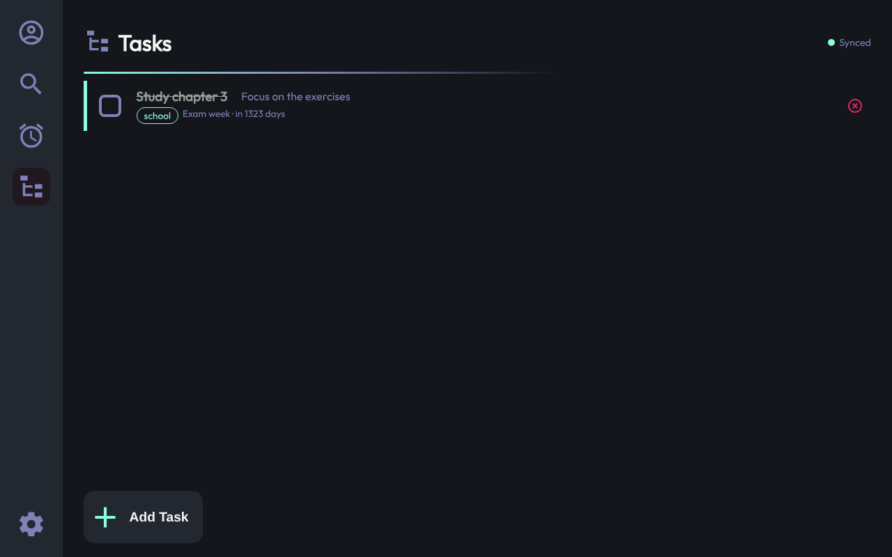

# GoDo

A to-do app with **tasks**, **deadlines** and **tags** that stays in **sync
across all your devices**. Log in on your laptop and your phone: a task you
add, tick off or edit on one shows up on the other within a second.

- **Backend:** Go, Gin, MongoDB
- **Frontend:** React 19, TypeScript, Vite
- **Sync:** per-user live event stream (Server-Sent Events) + versioned edits



## Features

| | |
|---|---|
| Tasks | Title, description, priority (low/medium/high), done checkbox, tags, linked deadlines |
| Deadlines | Title, date and time, description, tags; shows linked tasks and progress ("2/3 tasks done"), marks passed deadlines |
| Tags | Create, rename, recolour and delete on the Settings page; deleting a tag removes it everywhere |
| Accounts | Register and log in with email and password; each device keeps its own login |
| Live sync | Changes appear on your other open devices immediately; offline devices catch up when they reconnect |
| Conflict safety | If two devices edit the same item, the second save is warned instead of silently overwriting |
| Search | Find tasks and deadlines by title, description or tag |

## Quick start (Docker)

Requires Docker with Compose.

```sh
docker compose up --build
```

Open <http://localhost:5173>, create an account, then open the same URL in a
second browser (or a private window) and log in to see sync in action.

For anything beyond local testing set your own secret first, for example in a
`.env` file next to `docker-compose.yml`:

```sh
JWT_SECRET=$(openssl rand -hex 32)
```

## Local development

Requirements: Go 1.25+, Node 22+, and a MongoDB 7 server (for example
`docker run -d -p 27017:27017 mongo:7`).

**Backend**

```sh
cd backend
cp .env.example .env      # then edit JWT_SECRET
go run ./cmd/godo         # http://localhost:8080
```

**Frontend**

```sh
cd frontend
npm install
npm run dev               # http://localhost:5173
```

The frontend talks to `http://localhost:8080` by default. Point it elsewhere
with `VITE_API_URL` (e.g. `VITE_API_URL=https://api.example.com npm run dev`).

### Configuration

All backend settings are environment variables (a `backend/.env` file is
loaded automatically). See [`backend/.env.example`](backend/.env.example).

| Variable | Default | Meaning |
|---|---|---|
| `MONGO_URI` | *(required)* | MongoDB connection string |
| `MONGO_DB` | `godo` | Database name |
| `JWT_SECRET` | *(required, ≥ 32 chars)* | Secret that signs login tokens |
| `TOKEN_TTL` | `168h` | How long a login stays valid |
| `PORT` | `8080` | HTTP port |
| `CORS_ORIGINS` | `http://localhost:5173` | Comma-separated frontend URLs |

## Tests

```sh
# Backend: unit, service and HTTP tests (in-memory storage)
cd backend && go test -race ./...

# Backend: also run the MongoDB repository tests
MONGO_TEST_URI=mongodb://localhost:27017 go test ./...

# Frontend: lint, unit and component tests, production build
cd frontend && npm run lint && npm test && npm run build
```

GitHub Actions runs all of the above on every push
([`.github/workflows/ci.yml`](.github/workflows/ci.yml)).

## Project structure

```
backend/
  cmd/godo/            entry point: config, MongoDB, wiring, graceful shutdown
  internal/
    config/            environment variables → Config
    models/            Task, Deadline, Tag, User (+ shared Meta)
    repository/        storage interfaces
      mongo/           MongoDB implementation
      memory/          in-memory implementation (tests)
      repotest/        contract tests both implementations must pass
    service/           business rules, validation, publishing changes
    auth/              bcrypt passwords, JWT tokens
    realtime/          per-user event hub
    api/               router, middleware, HTTP handlers
frontend/src/
  api/                 fetch wrapper (base URL, token, errors)
  services/            one module per API resource
  sync/                event stream reader + pure state reducer
  context/             AuthProvider, DataProvider (state + actions)
  hooks/               useTasks, useDeadlines, useTags, ...
  components/          pages, lists, forms, shared UI
  utils/               validation, dates, search
  styles/              CSS, mirroring the components folder
```

## More documentation

- [Architecture and sync design](docs/ARCHITECTURE.md)
- [HTTP API reference](docs/API.md)
